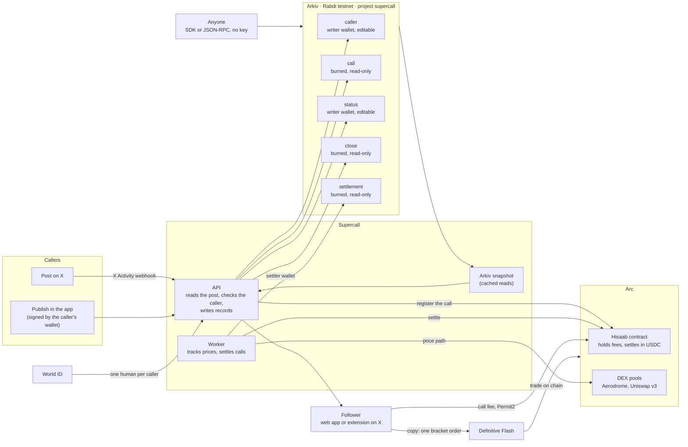
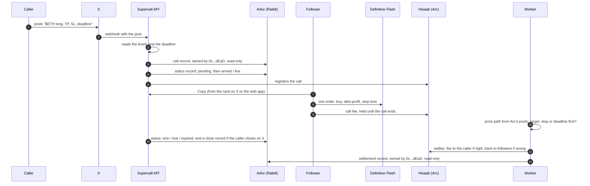

# Architecture

How a call moves through Supercall, and which part of it lives on Arkiv. GitHub renders the
diagrams below.

## The pieces

## The life of one call

## What to check on Arkiv

- Every call, close and settlement is created by the writer wallet
  (`0x69C9Fb11006788a118520eD66518a666c0cf0772`) or the settler wallet
  (`0x59B6D1d967bdf035E3849f244063c3F61411A0dE`), then handed to the burn address
  `0x000000000000000000000000000000000000dEaD` and marked read-only. No key can edit them.
- Callers and statuses stay owned by the writer wallet, because they change over a call's life.
- Open a call on the Rabdi explorer: `https://rabdi.explorer.arkiv.network/entity/<call key>`.
  The call page's "Verify on Arkiv" link does this.
- Query every open call with no key: see [the README](../README.md#a-query-you-can-run).

Records, owners and indexed fields: [schema.md](schema.md). Why Arkiv: [why-arkiv.md](why-arkiv.md).
